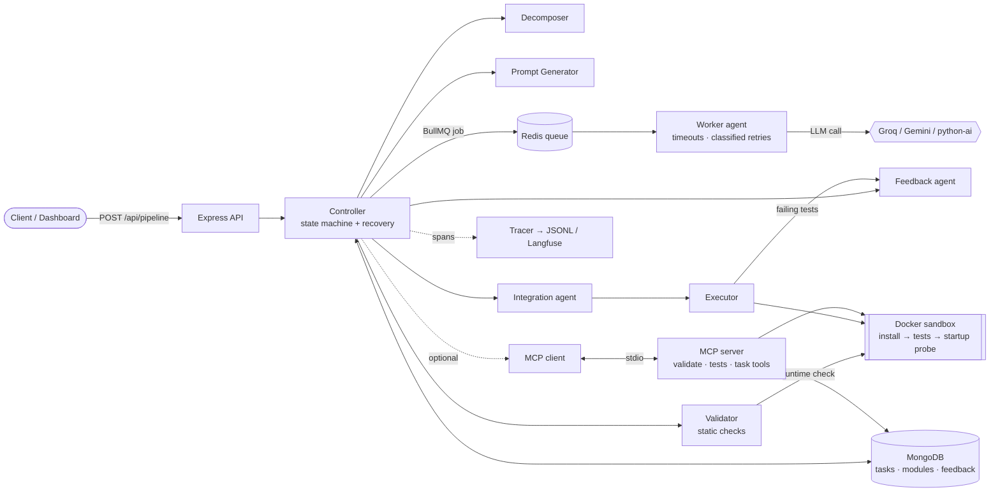
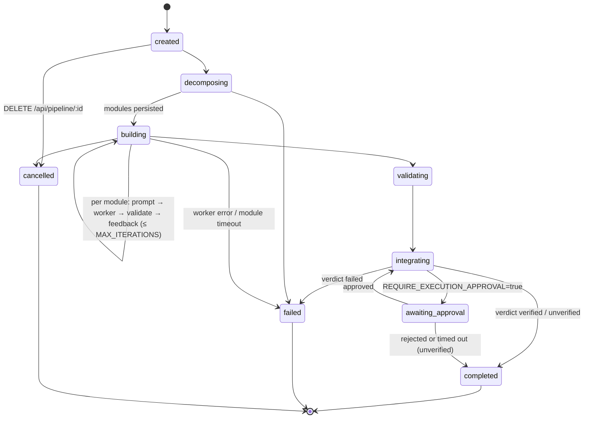

# Multiagent AI Factory

A multi-agent pipeline that turns a one-line software idea into a generated Node.js/Express project, **runs the generated tests inside a locked-down Docker sandbox, feeds real failures back to the coder, and reports an honest verdict** — `verified`, `unverified` or `failed` — instead of "the workflow finished".

> **Who it's for:** engineers exploring reliable, measurable LLM agent workflows — tool use (MCP), state/recovery, observability and evals — rather than a chat demo.
> **Status:** portfolio/learning project. Everything below is marked *implemented*, *optional*, or *not done*; nothing is claimed that isn't backed by a test or a command you can run.

## Contents
[Architecture](#architecture) · [Lifecycle](#pipeline-lifecycle) · [Feature status](#feature-status) · [Quick start](#quick-start) · [API](#api) · [Configuration](#configuration) · [Security model](#security-model) · [Observability](#observability) · [MCP](#mcp) · [Evals](#evals) · [Reliability](#reliability-semantics) · [Tests & CI](#tests--ci) · [Limitations](#known-limitations) · [Layout](#repository-layout)

## Architecture



## Pipeline lifecycle



| Agent | Responsibility |
|---|---|
| **Decomposer** | Idea → ordered modules (keyword/domain based, deterministic) |
| **Prompt generator** | Per-module prompt, built right before the module so it can reference real exports of finished siblings |
| **Worker** | Calls the LLM with a per-request timeout and *classified, bounded* retries; records provider, model, attempts, tokens and whether a fallback template was substituted |
| **Validator** | Static checks (syntax, exports, error handling, secrets…) + a runtime load/call check **inside Docker** |
| **Feedback** | Turns validator issues — or real failing tests — into a refined prompt (with the previous code) |
| **Integration** | Assembles files, `package.json`, entry point, generated tests, frontend |
| **Executor** | Sandboxed `npm install` + `jest` + startup/health probe; blames failing tests on modules for the repair loop |
| **Controller** | Orchestration, persistence, cancellation, de-duplication, timeouts, restart recovery, verdict |

## Feature status

| Feature | State | Evidence |
|---|---|---|
| Multi-agent pipeline with bounded validate→feedback retries | **Implemented** | `src/core/controller.js`, `tests/controller.test.js` |
| Honest verdict (`verified` / `unverified` / `failed`) | **Implemented** | `src/core/outcome.js`, `tests/outcome.test.js` |
| Docker sandbox: no host execution, fail-closed if Docker is missing | **Implemented**; exercised against real Docker during development | `src/agents/executor.js`, `src/agents/runtimeCheck.js`, `tests/executor.test.js` |
| Execution → coder repair loop | **Implemented** | `executeWithRepair`, controller tests |
| Startup + health probe of the generated app | **Implemented**; informational unless `EXEC_REQUIRE_STARTUP=true` | `tests/executor.test.js` |
| LLM error classification, timeouts, bounded retries, secret redaction | **Implemented** | `src/services/llmErrors.js`, `tests/worker.test.js` |
| Restart recovery (resume from persisted modules), cancellation, de-duplication, module timeouts | **Implemented** against a fake DB; **not** run against a live MongoDB/Redis | controller tests |
| Optional human approval before executing generated code | **Implemented** (off by default) | `REQUIRE_EXECUTION_APPROVAL` |
| Tracing (JSONL always; Langfuse optional) | **Implemented**; Langfuse export verified only against an unreachable server and a stub | `src/observability/tracer.js`, `tests/tracer.test.js` |
| MCP server + client, approval-gated sensitive tools | **Implemented**, tested over stdio and in-memory transport | `src/mcp/`, `tests/mcp*.test.js` |
| Evals: codegen (executable hidden tests), tool selection, pipeline | **Implemented**; deterministic mock mode in CI | `evals/` |
| Live-model baseline numbers | **No saved result files** — see [Evals](#evals) | — |
| LangGraph / DeepAgents | **Deliberately not used** — see [docs/ARCHITECTURE.md](docs/ARCHITECTURE.md) | — |
| `python-ai` provider (external FastAPI/LangGraph/CrewAI service described in `DOCS.md`) | **Optional, external, untested here** | `src/services/aiService.js` |
| Repair-round budget across restarts | **Implemented** (`Task.repairRound`); the sandbox itself is re-run on resume | `tests/controller.test.js` |
| Optional API-key auth | **Implemented**, off by default | `src/api/auth.js`, `tests/auth.test.js` |

## Quick start

Requirements: Node ≥ 18.14, Docker (MongoDB/Redis and the sandbox), and a Groq or Gemini key — or `AI_PROVIDER=simulated` for an offline template demo (verdicts are capped at `unverified`).

```bash
cp .env.example .env              # add GROQ_API_KEY (or GEMINI_API_KEY), set AI_PROVIDER
docker compose up -d mongodb redis
npm install
npm start                         # dashboard + API on http://localhost:3000
```

> Default models are `openai/gpt-oss-120b` / `openai/gpt-oss-20b` (Groq) and `gemini-3.8-flash` (Gemini); both were verified with live calls when chosen. Provider catalogs change - if a model is retired, override `GROQ_MODEL_FAST|QUALITY|LIGHT` / `GEMINI_MODEL_*`, otherwise the worker falls back to templates and the run is reported `failed`.

Development & tests:

```bash
npm test                          # unit + deterministic integration tests (no DB, Docker or API key)
npm run eval:codegen:mock         # deterministic eval smoke (scripted model)
npm run eval:validate             # result-file schema check
node scripts/check-secrets.js     # secret scan of tracked files
```

## API

| Method & path | Purpose |
|---|---|
| `POST /api/pipeline` `{ "idea": "…" }` | Start a run. `201` new, `200` + `duplicate:true` if an identical run is in flight |
| `GET /api/pipeline/:taskId` | Status, per-module scores, history |
| `GET /api/pipeline/:taskId/output` | Files, `execution`, `executionAttempts`, `outcome` |
| `GET /api/pipeline/:taskId/download` | Generated project as a zip |
| `GET /api/pipeline/:taskId/stream` | Server-sent events |
| `DELETE /api/pipeline/:taskId` | Cancel a running pipeline |
| `POST /api/pipeline/:taskId/approve` `{ "approved": true }` | Release the execution-approval gate |
| `GET /api/pipelines`, `GET /api/health` | List runs, health |

Response shapes (values illustrative):

```jsonc
// POST /api/pipeline  → 201
{ "success": true, "data": { "taskId": "6f0c…", "status": "started", "duplicate": false } }

// GET /api/pipeline/:id/output  (finalOutput, abridged)
{
  "outcome": { "verdict": "failed", "reasons": ["Generated project failed in the sandbox (17/18 tests passed): 1 test failure(s)"] },
  "execution": { "success": false, "installSuccess": true, "tests": { "total": 18, "passed": 17, "failures": [{ "file": "tests/auth-module.test.js", "test": "…", "message": "…" }] },
                 "startup": { "attempted": true, "started": false, "healthOk": false, "error": "process exited with code 1 before becoming healthy" } },
  "executionAttempts": [{ "round": 0, "success": false }, { "round": 1, "success": false }],
  "files": [{ "path": "src/index.js", "content": "…", "module": "Entry Point" }]
}
```

## Configuration

Copy `.env.example`. The settings that matter most:

| Variable | Default | Meaning |
|---|---|---|
| `AI_PROVIDER` | `groq` | `groq` · `gemini` · `python-ai` · `simulated` |
| `GROQ_MODEL_*`, `GEMINI_MODEL_*` | gpt-oss-120b/20b, gemini-3.8-flash | Model ids per tier |
| `API_KEY` | unset (API open, warning logged) | If set, `/api/*` (except `/api/health`) needs `Authorization: Bearer <key>` or `X-API-Key` |
| `LLM_MAX_ATTEMPTS` / `LLM_TIMEOUT_MS` / `LLM_BASE_DELAY_MS` / `LLM_MAX_RETRY_WAIT_MS` | 3 / 60000 / 1000 / 15000 | Worker retry & timeout policy |
| `LLM_FALLBACK` | template | `off` = throw instead of substituting template code |
| `LLM_PRICE_IN_PER_MTOK` / `LLM_PRICE_OUT_PER_MTOK` | unset | Cost is only estimated if you supply prices |
| `MAX_ITERATIONS`, `QUALITY_THRESHOLD` | 3, 70 | Validate→feedback retry budget, pass score |
| `MODULE_TIMEOUT_MS`, `DEDUPE_WINDOW_MS` | 300000, 600000 | Worker wait bound, duplicate-request window |
| `PIPELINE_RESUME` | on | `false` = fail interrupted tasks instead of resuming |
| `REQUIRE_EXECUTION_APPROVAL`, `APPROVAL_TIMEOUT_MS` | off, 30 min | Human gate before running generated code |
| `EXEC_IMAGE/MEMORY/CPUS/PIDS_LIMIT` | `node:20-alpine`, 512m, 1, 256 | Sandbox limits |
| `EXEC_INSTALL_TIMEOUT_MS/TEST_TIMEOUT_MS/STARTUP_TIMEOUT_MS` | 120s / 90s / 10s | Phase timeouts |
| `EXEC_MAX_REPAIR_ROUNDS`, `EXEC_REQUIRE_STARTUP` | 2, off | Repair budget; make a healthy startup mandatory |
| `VALIDATOR_RUNTIME` | docker | `off` disables the runtime check (it never falls back to the host) |
| `MCP_ENABLED`, `MCP_ALLOWED_TOOLS`, `MCP_WORKSPACE`, `MCP_REQUIRE_APPROVAL` | off | See [MCP](#mcp) |
| `LANGFUSE_PUBLIC_KEY/SECRET_KEY/BASEURL`, `TRACE_FILE` | unset, `logs/traces.jsonl` | See [Observability](#observability) |

## Security model

Generated code and the packages it installs are **untrusted**. What is enforced (and tested):

- **No host execution.** Install, tests, startup probe, the validator's runtime check, and live-eval grading all run in throw-away containers. If Docker is unavailable the step is `skipped` and the verdict cannot be `verified`. Node's `vm` is used *only inside the container*; it is not treated as a boundary.
- **Container hardening:** non-root user, `--cap-drop ALL`, `no-new-privileges`, read-only root filesystem, memory/CPU/pids limits, hard timeouts with forced container removal. `npm install --ignore-scripts` (network on); tests/probe/validation with **`--network none`** and a read-only project mount.
- **File writes:** every path is validated before anything is written (no `..`, absolute, backslash, null byte, `node_modules/`, `.git/`; file count and size caps).
- **Secrets:** logs, traces, persisted errors and API error text are redacted (key shapes + known env secret values). `scripts/check-secrets.js` scans tracked files in CI.
- **MCP:** least-privilege allow-list, workspace-confined file tools, no shell tool, HMAC approval tokens for sensitive tools (details below).

Remaining risks: `npm install` of arbitrary package names (typosquats; scripts are disabled and the container is isolated, but a malicious package could still run when imported by tests inside the no-network container); container escape via a Docker/kernel vulnerability; 2 moderate `uuid` advisories (via `bullmq`, `uuid` v4 without the affected `buf` argument; fix is a breaking upgrade); API authentication is opt-in (`API_KEY`) and off by default; with it on, the bundled dashboard and the browser `EventSource` stream cannot authenticate (keys are header-only by design) - use curl/a proxy; the Python service's `/api/progress` callback must send the key too; the SSE stream carries logs.

## Observability

Every run is one trace (`id = taskId`) with nested spans: `decompose` → `prompt:*` → `module:*` (each attempt) → `llm.generate` (model, tokens, attempts, fallback) / `validate` / `feedback` → `integrate` → `sandbox.execute` → `sandbox.install|test|startup`, plus `mcp.<tool>` calls and `eval:*` spans. BullMQ jobs carry the trace context so queue-worker spans attach to the right trace.

- **Always on:** `logs/traces.jsonl` (one JSON span per line; `TRACE_FILE=off` disables). Inspect with `jq 'select(.traceId=="<taskId>")' logs/traces.jsonl`.
- **Langfuse (optional):** set `LANGFUSE_PUBLIC_KEY` / `LANGFUSE_SECRET_KEY` (and `LANGFUSE_BASEURL` for self-hosted). Open the trace whose id equals the `taskId`. Export failures are swallowed, requests have short timeouts, and shutdown flush is bounded, so an offline Langfuse cannot hang or break the app.
- Inputs/outputs are size-capped and redacted before they reach any sink.

## MCP

`src/mcp/server.js` (stdio) exposes:

| Tool | Access | Notes |
|---|---|---|
| `get_task_status`, `get_validation_report`, `inspect_project_files` | read-only (MongoDB) | verdict + reasons, per-module scores/issues, generated files |
| `validate_code`, `list_project_files`, `read_project_file` | read-only | file tools are confined to `MCP_WORKSPACE`, size-capped, symlink-safe |
| `run_project_tests`, `run_unit_tests` | **sensitive** — not discoverable unless allow-listed, and each call needs a host-minted approval token | run in the Docker sandbox |

Defaults: read-only tools only. Sensitive tools are registered only if listed in `MCP_ALLOWED_TOOLS` **and** the server has an approval secret; the client mints a short-lived HMAC token bound to the tool and exact arguments only after its `approver` callback returns true (default: deny). A model that merely chooses a tool cannot approve itself. With `MCP_ENABLED=true` the pipeline routes validation and sandboxed test runs through this client/server pair.

```js
const { McpToolClient } = require('./src/mcp/client');
const client = await new McpToolClient({
  allowedTools: ['get_task_status', 'run_project_tests'],
  approver: async ({ tool, args }) => askAHuman(tool, args),   // required for run_project_tests
}).connect();
client.listTools();                                            // discovery
await client.callTool('get_task_status', { taskId });          // → { status, verdict, modules, … }
```

## Evals

Three suites under `evals/`, all writing schema-validated JSON (`evals/results/*.json`) that states its denominators and configuration:

| Suite | What it measures | Grading |
|---|---|---|
| `codegen` (20 tasks, 101 hidden cases) | task success, first-attempt success, **retry recovery**, test-case pass rate, structured-output validity, failure classes, latency, tokens, cost (only with supplied prices) | hidden executable tests; model output graded **in Docker** |
| `tools` (12 scenarios) | tool-selection accuracy, unnecessary calls, argument validity, execution success, **guardrail hold rate** (path-escape attempts refused) | real MCP server + client |
| `pipeline` (30 ideas) | decomposition recall, validator pass rates, requirement coverage, sandbox success, fallback rate | heuristic + sandboxed tests |

```bash
npm run eval:codegen:mock                                  # deterministic, free, CI
npm run eval:codegen -- --mode live --label baseline --limit 5   # real model, needs Docker + a working provider
npm run eval:tools   -- --mode mock --behavior oracle      # or --mode live (Groq function calling)
npm run eval:compare -- evals/results/a.json evals/results/b.json   # exits 1 on regression; refuses mixed suite/mode/provider/dataset
```

**Sample report — mock mode** (`evals/results/codegen-mock.json`; a *scripted* model that is perfect on 8 tasks, wrong-then-fixed on 4, always wrong on 4 and always syntactically broken on 4 — it validates the eval machinery, **not any LLM**):

```
tasks 20 · graded 20 · provider errors 0 · failed first attempt 12 · test cases 101
task success 12/20 = 0.600 · first attempt 8/20 = 0.400 · retry recovery 4/12 = 0.333
test-case pass rate 59/101 = 0.584 · structured-output validity 16/20 = 0.800
failure classes: wrong_answer 4, syntax_error 4
```

**Live baselines: no saved result files yet.** Observations so far, honestly stated:

- A one-off live run of the *original* 14 easy tasks (Groq `openai/gpt-oss-120b`, graded in Docker, ~420 tokens/task) passed **14/14 on the first attempt**. That file was not kept and the dataset has since grown, so treat it as an observation, not a baseline. It also showed the first dataset was too easy to discriminate, so 6 harder tasks (interval merging, version comparison, CSV parsing, topological sort, number spelling, glob matching) were added.
- The 20-task live run could not complete: Groq's free tier (200k tokens/day) was exhausted. The runner stopped on the non-recoverable quota error after one task instead of grading template output, and wrote a report with `providerErrors: 1` and null rates (which was deleted rather than published).
- Provider errors are excluded from success denominators and always reported. Mock and live results can never be compared.

To produce a real baseline once quota is available: `npm run eval:codegen -- --mode live --label codegen-live-<model>`, then commit the generated `evals/results/codegen-live-*.json`.

Evals found two real bugs while being built: `extractCode` truncated model output that started with `function …`, and generated "export" tests failed for every `module.exports = x` module — both fixed with regression tests.

## Reliability semantics

- **Completion ≠ success.** Verdict rules: any module that never passed validation, any LLM failure masked by a template, or failing sandbox tests → `failed` (artifact still saved for inspection). Sandbox unavailable or `simulated` provider → `unverified`.
- **Bounded everything:** validator retries (`MAX_ITERATIONS`), repair rounds, worker wait (`MODULE_TIMEOUT_MS`), LLM attempts/timeouts, approval wait, sandbox phase timeouts.
- **Restart recovery:** on startup, non-terminal tasks are resumed from persisted modules (completed modules are not redone; prompts are reused) at most twice, otherwise marked `failed` with the reason. Job ids include a per-run id so leftovers from before a restart can't be dropped as duplicates.
- **Failure persistence:** worker errors, timeouts, queue/DB errors and cancellation all end in a persisted terminal status; if the DB itself is down, recovery settles the task at next start.
- **Duplicate requests** for the same in-flight idea return the existing task.

Details and the framework decision: [docs/ARCHITECTURE.md](docs/ARCHITECTURE.md).

## Tests & CI

```bash
npm test      # 270 tests across 19 suites; no MongoDB, Redis, Docker or API key required
```

`.github/workflows/ci.yml` runs on pull requests: `npm ci`, the test suite (Node 18 and 20), the mock codegen eval + result-schema validation, a secret scan and `npm audit --omit=dev --audit-level=high`. **The workflow has not run yet** (it has only been validated locally as YAML and by running each step by hand); don't treat CI as passing until a run confirms it. No linter is configured.

## Known limitations

- No saved live-LLM eval baseline (provider quota); retired default model ids need overriding.
- Generated tests are structural (module loads, exports exist); `verified` means *they and the validator passed*, not that the app is behaviourally correct.
- Controller/queue/Mongo paths are tested with fakes, not against live MongoDB/Redis.
- API auth is opt-in and header-only (see above); no LangGraph/DeepAgents (by design, see architecture doc); Python AI service is external.

## Repository layout

```
src/agents/         decomposer · promptGenerator · worker · validator(+runtimeCheck) · feedback · integration · executor
src/core/           controller · pipeline (state machine) · outcome (verdict)
src/services/       llmErrors (classify/retry) · aiService (python-ai)
src/mcp/            server · client · toolbox · tools · taskTools · approval
src/observability/  tracer
src/utils/          safePath · redact · logger · retry
evals/              codegen/ · tools/ · dataset.json (pipeline) · metrics · compare · schema
scripts/            check-secrets.js
tests/              unit + deterministic integration tests (+ helpers/fakeDb)
docs/               ARCHITECTURE.md
DOCS.md             long-form design notes (describes an external LangGraph/CrewAI service)
```
